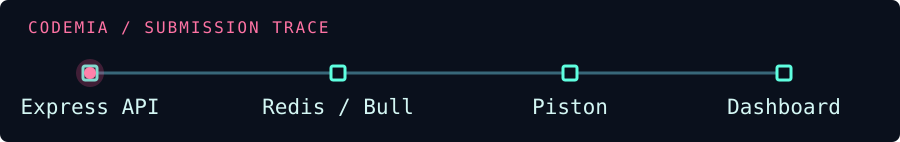

Hey, I’m Girish. I write backend software and study Robotics & Automation at Symbiosis Institute of Technology. Two of my favorite builds started with very different questions. How do you grade a classroom’s worth of code submissions without making everyone wait? And how do you keep a camera tracking an object when it disappears for a few frames?

## ★ Main quest · Samant Solutions

**Backend Engineer Intern** · June 2026–present · Remote

I build and deploy FastAPI services for 20+ clients. I write async handlers for concurrent requests, help design the database schemas behind them, and document how to run and maintain each API after handoff.

## ◆ Gig · STROTA ConsulTech

**Intern** · November 2026–present

I build AI-powered workflow tools for small businesses and startups. My work runs from conversations with clients about repetitive tasks to implementing the software, testing its AI integrations, and maintaining it after deployment.

## ◇ Side quests

### Software

| Build | Inside the repo |
| --- | --- |
| [Codemia](https://github.com/giri5hsharma/Codemia) | Instructors write test cases, students submit code, and Redis/Bull workers queue submissions for grading in five languages. The React dashboard shows correctness, runtime, and memory feedback. **National finalist and special mention at Rewind and Recode.** |
| [Smart Hospital Room Monitoring](https://github.com/giri5hsharma/Cloud-Hospital-Monitoring) | Three of us built a simulated room monitor on Azure. The Flask dashboard explains each alert and flags a feed that’s gone quiet. We traced 22 readings end to end by record ID and passed all 28 cloud tests. |
| [FastAPI Blog](https://github.com/giri5hsharma/fast_api_blog) | A blog with 13 REST handlers, async database sessions, and OAuth2/JWT login. Authors can edit and delete their own posts, with ownership checks on both operations. |
| [Industrial Material Defect Detection](https://github.com/giri5hsharma/Industrial-Material-Testing) | Upload a material image and a Flask app returns an anomaly score and a heatmap showing where to look. I trained EfficientAD on defect-free samples and evaluated it across six material categories. |

### Robotics & embedded systems

| Build | Inside the repo |
| --- | --- |
| [UGV Gimbal Simulator](https://github.com/giri5hsharma/AI-Driven_Dynamic_Target_Tracking_and_Gimbal_Stabilization) | When an object briefly slips out of view, a Kalman filter estimates its motion between detections. Try the tracking software with a camera, a video file, or the synthetic demo. Pan and tilt are simulated. |
| [ESP32 Pest Detection](https://github.com/giri5hsharma/Pest-detection-using-ESP-32S) | I trained a CNN on 32×32 pest images, quantized it to int8, and exported it as a C header for ESP32-CAM integration. A separate Arduino demo ties the sensor, display, and buzzer together. |

[Explore all repositories →](https://github.com/giri5hsharma?tab=repositories) · [Connect on LinkedIn ↗](https://www.linkedin.com/in/giri5hsharma/)
