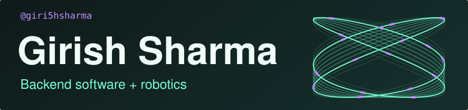

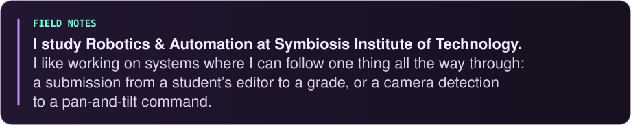

<h2></h2>

<strong>Languages</strong> 
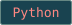

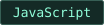

<strong>Web &amp; APIs</strong> 
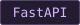
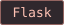

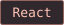

<strong>Cloud &amp; queues</strong> 

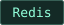
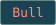

<strong>Vision &amp; robotics</strong> 
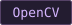

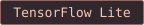
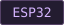

<h2>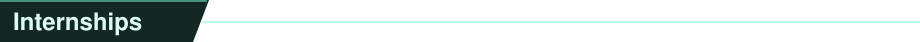</h2>

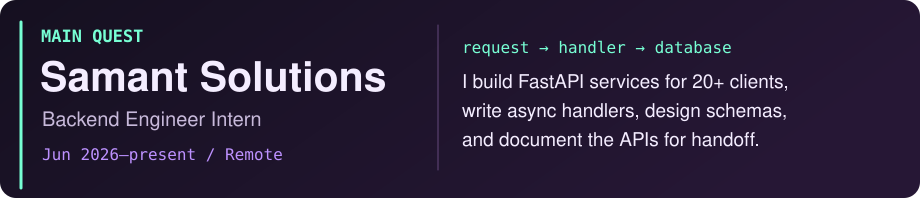

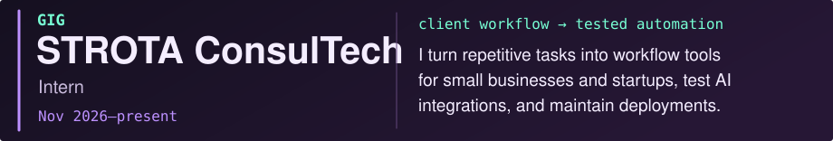

<h2></h2>

<h3></h3>

<a href="https://github.com/giri5hsharma/Codemia">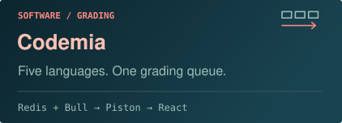</a> <a href="https://github.com/giri5hsharma/Cloud-Hospital-Monitoring">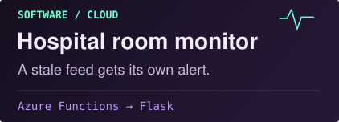</a>

<a href="https://github.com/giri5hsharma/fast_api_blog">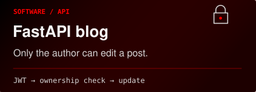</a> <a href="https://github.com/giri5hsharma/Industrial-Material-Testing">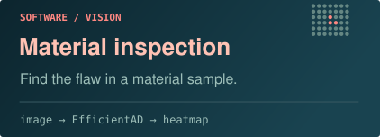</a>

Build notes

- **[Codemia](https://github.com/giri5hsharma/Codemia)** · Students submit code and instructors define the tests. Workers grade submissions in five languages and report correctness, runtime, and memory use. National finalist and special mention at Rewind and Recode.
- **[Hospital room monitor](https://github.com/giri5hsharma/Cloud-Hospital-Monitoring)** · Three of us built a simulated room monitor. We traced 22 readings from ingestion to the dashboard by record ID and passed all 28 cloud tests.
- **[FastAPI blog](https://github.com/giri5hsharma/fast_api_blog)** · I built 13 REST handlers backed by asynchronous SQLAlchemy sessions, with OAuth2/JWT login and ownership checks on updates and deletes.
- **[Material inspection](https://github.com/giri5hsharma/Industrial-Material-Testing)** · I trained EfficientAD on defect-free samples across six material categories. A Flask upload returns an anomaly score and a heatmap that locates the suspected defect.

<h3></h3>

<a href="https://github.com/giri5hsharma/AI-Driven_Dynamic_Target_Tracking_and_Gimbal_Stabilization">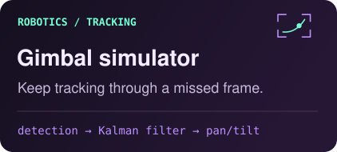</a> <a href="https://github.com/giri5hsharma/Pest-detection-using-ESP-32S">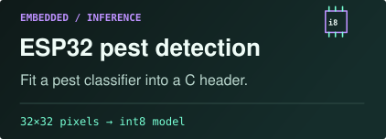</a>

Build notes

- **[Gimbal simulator](https://github.com/giri5hsharma/AI-Driven_Dynamic_Target_Tracking_and_Gimbal_Stabilization)** · I used a Kalman filter to estimate motion between detections and calculate simulated pan and tilt. The app takes a camera feed, a video file, or a synthetic demo.
- **[ESP32 pest detection](https://github.com/giri5hsharma/Pest-detection-using-ESP-32S)** · I trained and quantized a CNN for ESP32-CAM integration. A separate Arduino demo connects the sensor, display, and buzzer.

<h2>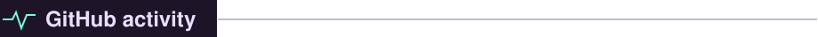</h2>

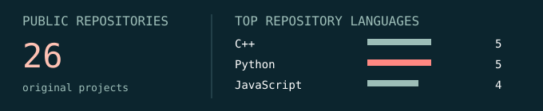

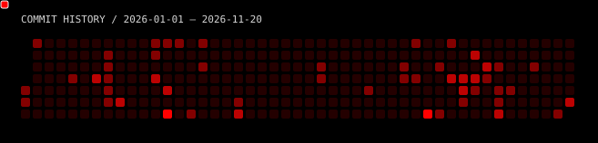

[Browse my repositories ↗](https://github.com/giri5hsharma?tab=repositories)　·　[LinkedIn ↗](https://www.linkedin.com/in/giri5hsharma/)
